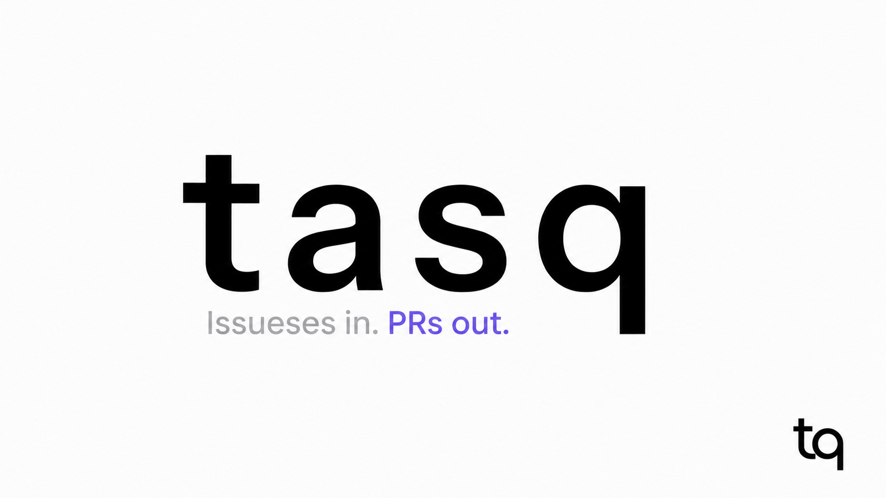

# tasq

AI が扱いやすい、ローカルファーストの課題管理ツール。

Tasq は、`tq` CLI と Web UI を通じて、人間と AI エージェントが作業の目的、課題の状態、成果を共有するためのツールです。

[](https://github.com/user-attachments/assets/8c4fdc9c-c70b-4f86-8e0a-323f8880ffb7)

English counterpart: [README.md](README.md).

## Tasq を使う理由

担当する人やエージェント、セッションが変わっても、作業の内容を理解できる必要があります。Tasq は、課題、優先度、依存関係、コメント、成果へのリンクを、人間と AI エージェントが使える一つのローカルな仕組みに集めることに注力します。

## 今後の方向性

Tasq は、AI が扱いやすいローカルファーストの課題管理ツールに開発の重点を移します。エージェントの実行やオーケストレーションは外部ツールに委ね、Tasq の中心的な責務としての拡張は行いません。

現在の配布物には引き続き orchestrator が含まれます。移行中のサポートは、セキュリティ、データの整合性、既存の作業手順に影響する回帰不具合の修正に限定し、新しいオーケストレーション機能の追加と Symphony 準拠の追加対応は停止します。この告知によって、既存のコマンド、保存済みデータ、実行時の動作は変わりません。

課題管理のみの運用を標準とする正式リリースの前に、単体運用の検証結果と既存 orchestrator の利用状況を確認し、任意機能としての維持、別リポジトリへの分離、提供終了のいずれとするかを公開します。削除時期は未定です。移行段階と互換性の方針は[ロードマップ](ROADMAP.ja.md)を参照してください。

課題とワークフロー、製品全体の説明は [Tasq ドキュメントサイト](https://version-1.github.io/tasq/ja/)を参照してください。

## Features

- エージェント向けサイズのタスク、優先度、依存関係、コメントを扱う課題キュー。
- タスク作成、状態更新、進捗コメント追加、ワークフローのスクリプト化に使う `tq` CLI。
- SQLite を使うローカルの issue-tracker、orchestrator、Web UI サービス。
- プロジェクト、課題、コメント、キューの状態、サービスの状態を確認する Web UI。
- 課題を実際のローカルリポジトリのパスに結び付けるプロジェクト登録。
- バイナリのみのローカル構成に必要な実行時バイナリを含むリリースアーカイブ。

## Install

確認したインストーラーで、最新の正式リリースアーカイブをインストールします。

```sh
curl -fsSLO https://raw.githubusercontent.com/version-1/tasq/main/scripts/install.sh
less install.sh
sh install.sh
```

インストール先、`TQ_HOME`、サービスの起動、更新については、[インストール](https://version-1.github.io/tasq/ja/getting-started/install)を参照してください。

## Documentation

チュートリアル、ガイド、概念、リファレンスは、[Tasq ドキュメントサイト](https://version-1.github.io/tasq/ja/)を参照してください。

課題管理を中心に外部エージェントと連携する workflow package は、同梱の[TQ Factory plugin](plugins/tq-factory/README.ja.md)を参照してください。
