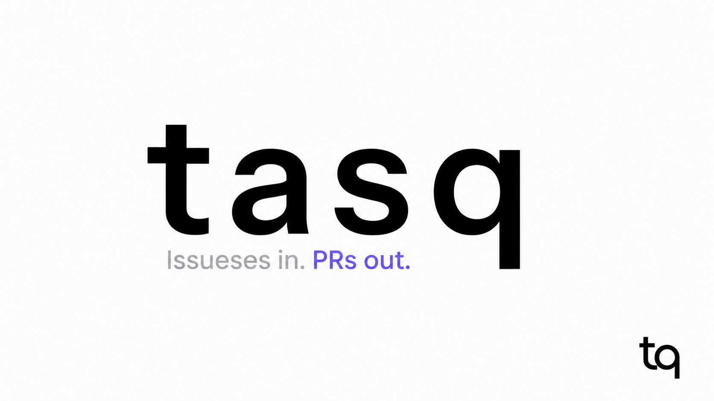

# tasq

An AI-friendly, local-first issue tracker.

Tasq helps humans and AI agents share work objectives, issue state, and outcomes through the `tq` CLI and Web UI.

[](https://github.com/user-attachments/assets/8c4fdc9c-c70b-4f86-8e0a-323f8880ffb7)

Japanese counterpart: [README.ja.md](README.ja.md).

## Why Tasq?

Work needs to remain understandable when people, agents, or sessions change. Tasq focuses on keeping issues, priorities, dependencies, comments, and links to outcomes in one local system that humans and AI agents can use.

## Product Direction

Tasq is shifting its development focus to an AI-friendly, local-first issue tracker. Agent execution and orchestration will be delegated to external tools rather than expanded as Tasq's core responsibility.

The current distribution still includes the orchestrator. During the transition, its support is limited to fixes for security, data integrity, and regressions affecting existing workflows; new orchestration features and additional Symphony conformance work are paused. This announcement does not change existing commands, stored data, or runtime behavior.

Before a stable release that makes tracker-only operation the default, we will review standalone tracker validation and existing orchestrator usage, then publish whether the orchestrator will remain optional, move to a separate repository, or be retired. No removal date has been set. See the [roadmap](ROADMAP.md) for transition stages and compatibility policy.

For the problem, workflow, and complete product overview, see the [Tasq documentation site](https://version-1.github.io/tasq/).

## Features

- Issue queue for agent-sized tasks, priorities, dependencies, and comments.
- `tq` CLI for creating tasks, updating state, adding progress comments, and scripting workflows.
- Local issue-tracker, orchestrator, and Web UI services backed by SQLite.
- Web UI for scanning projects, issues, comments, queue status, and service state.
- Project registration so issues stay tied to a real local repository path.
- Release archives that include the runtime binaries needed for a binary-only local setup.

## Install

Install the latest formal release archive with the reviewed installer:

```sh
curl -fsSLO https://raw.githubusercontent.com/version-1/tasq/main/scripts/install.sh
less install.sh
sh install.sh
```

For installation directories, `TQ_HOME`, service startup, and updates, see [Installation](https://version-1.github.io/tasq/getting-started/install).

## Documentation

Visit the [Tasq documentation site](https://version-1.github.io/tasq/) for the tutorial, guides, concepts, and reference.
